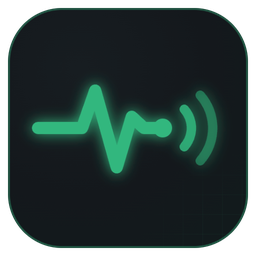
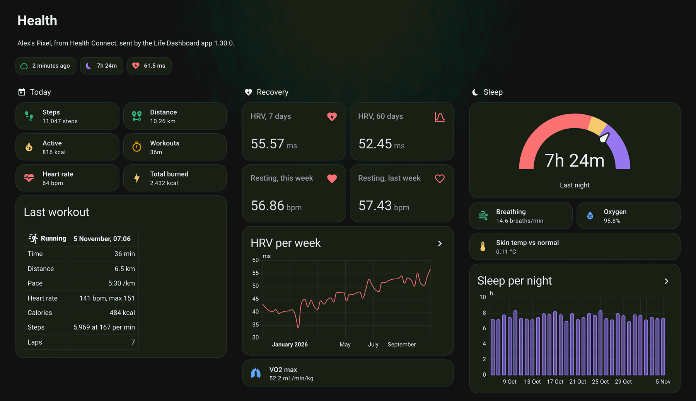
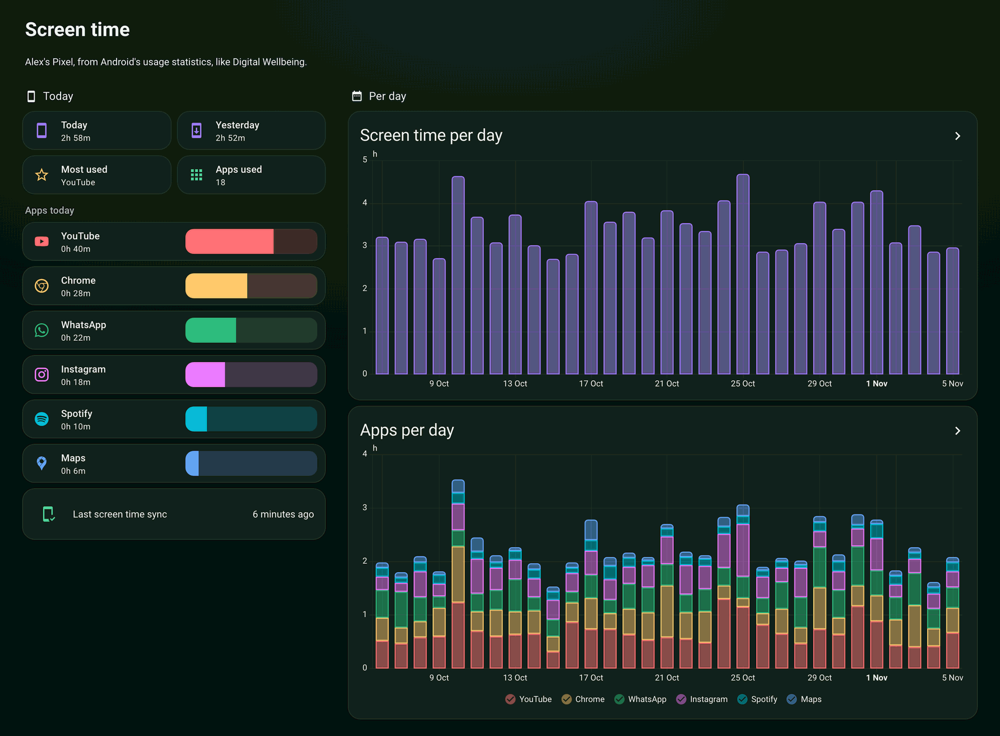
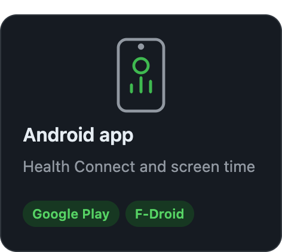
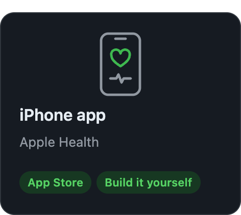
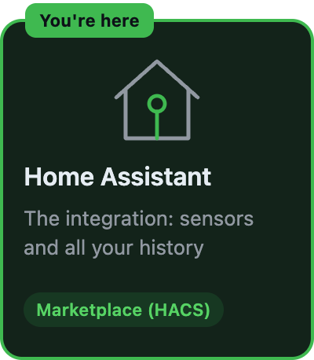
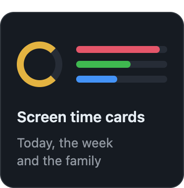
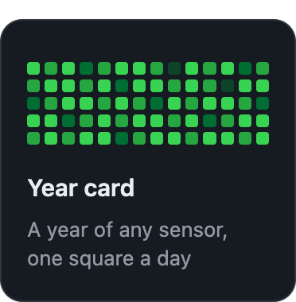
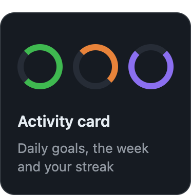
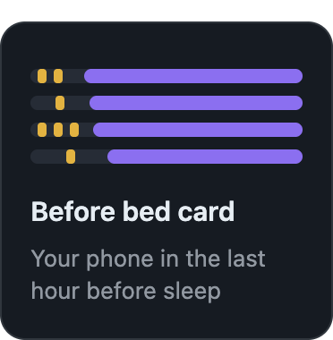

  

<h1 align="center">Life Dashboard for Home Assistant</h1>

  <b>Steps, sleep, heart rate, weight and workouts from your phone as Home Assistant sensors, with all your history.</b> 
  From Samsung Health, Fitbit, Garmin, Oura, Withings or Apple Health. Paired with a QR code: no broker, no YAML to set up.

  
  
  
  

  <a href="https://github.com/owen282000/life-dashboard-ha#quick-start"><b>Quick&nbsp;start</b></a>
  &nbsp;·&nbsp;
  <a href="https://github.com/owen282000/life-dashboard-ha/blob/main/docs/dashboard.md">Dashboard</a>
  &nbsp;·&nbsp;
  <a href="https://github.com/owen282000/life-dashboard-ha/blob/main/docs/pairing.md">Pairing</a>
  &nbsp;·&nbsp;
  <a href="https://github.com/owen282000/life-dashboard-ha/blob/main/docs/entities.md">Sensors</a>

<!-- life-dashboard:nav -->

  Life Dashboard: <a href="https://github.com/owen282000/life-dashboard-companion-app">Android app</a> &nbsp;·&nbsp; <a href="https://github.com/owen282000/life-dashboard-companion-app-ios">iPhone app</a> &nbsp;·&nbsp; <b>Home Assistant integration</b> &nbsp;·&nbsp; <a href="https://github.com/owen282000/life-dashboard-stack">Grafana stack</a> &nbsp;·&nbsp; <a href="https://github.com/owen282000/life-dashboard-sleep-card">Sleep card</a> &nbsp;·&nbsp; <a href="https://github.com/owen282000/life-dashboard-screen-time-card">Screen time cards</a> &nbsp;·&nbsp; <a href="https://github.com/owen282000/life-dashboard-year-card">Year card</a> &nbsp;·&nbsp; <a href="https://github.com/owen282000/life-dashboard-activity-card">Activity card</a> &nbsp;·&nbsp; <a href="https://github.com/owen282000/life-dashboard-before-bed-card">Before bed card</a>

<!-- /life-dashboard:nav -->

You need the Life Dashboard app on your phone to send your data here. It's a separate app from Home Assistant's Companion app.

 

  <a href="https://github.com/owen282000/life-dashboard-ha/blob/main/docs/dashboard.md"><picture><source media="(max-width: 600px)" srcset="https://raw.githubusercontent.com/owen282000/life-dashboard-ha/main/docs/screenshots/dashboard-hero-phone.png"></picture></a>
   
  An example <a href="https://github.com/owen282000/life-dashboard-ha/blob/main/docs/dashboard.md">dashboard</a> to copy, built from Home Assistant's own cards, with heart rate variability, resting heart rate and VO2 max under recovery. The screenshot shows demo data.

Your watch, ring or scale already writes to Health Connect or Apple Health on your phone. The app sends that data, from every source at once, straight to your Home Assistant. There is no account, and nothing passes through a server of mine.

- **Any brand, through the phone.** If it writes to Health Connect or Apple Health, it arrives, with no cloud login and no developer app to register per brand. The phone pushes; nothing here polls.
- **Android and iPhone in one integration.** Each phone is a device of its own, so a mixed household shares one dashboard.
- **Day totals that add up.** Steps, distance and calories are the phone's own figure for the day, so a walk recorded by both phone and watch counts once, and a day that is sent again or corrected replaces itself.
- **History that stays.** Every day lands on the date it happened, in Home Assistant's own statistics. When you change phones, the new one can take over the old one's history.
- **Stable within 1.x.** An update never breaks your entities, statistics, automations or pairing. [What 1.x keeps stable](https://github.com/owen282000/life-dashboard-ha/blob/main/docs/compatibility.md) lists it.

## What you get

- **Sensors for today.** Steps, distance and calories as day totals, and the latest heart rate, sleep, weight, blood pressure, glucose and more, each with the app that recorded it.
- **All your history.** Every day goes into long-term statistics on its own date, so a backfill from the phone fills the **Statistics graph** card as far back as the phone has data, with distance in km and sleep in hours. Use that card for the past: a sensor's own history only knows when a value arrived, so a backfill would land on a single day there.
- **Sleep stages.** Hours of deep, light, REM and awake per night as statistics, as far back as the phone has them, and the last night's stages with their times, ready for a card. The [Sleep card](https://github.com/owen282000/life-dashboard-sleep-card) draws the night.
- **Workouts.** The last workout and the minutes of today and yesterday, with every session's kind, start and end, and what was recorded during it: calories, distance, pace or speed, heart rate, steps, and on Android laps and sets. A shortest workout setting keeps the walks the phone notices by itself out.
- **What you eat.** Calories, protein, carbs and fat of today's meals, from the app you log your food in, with every day as a statistic.
- **Screen time per app** (Android). Today and yesterday with every app, the most used app, and per app a sensor and its history if you want one. The [Screen time cards](https://github.com/owen282000/life-dashboard-screen-time-card) show today, the week and the whole family.
- **Back into Health Connect** (Android). Map a scale or blood pressure entity, and the phone writes each new reading into Health Connect. Samsung Health and Google Health pick up weight and body fat from there.
- **A dashboard and a theme to copy.** The example [Health dashboard](https://github.com/owen282000/life-dashboard-ha/blob/main/docs/dashboard.md) above, a screen time view, a view for two phones side by side, and a theme in the colors of the apps, all from Home Assistant's own cards. It's an example: you paste it into a new dashboard and fill in your phone's name and ID.

  <a href="https://github.com/owen282000/life-dashboard-ha/blob/main/docs/dashboard.md#screen-time"><picture><source media="(max-width: 600px)" srcset="https://raw.githubusercontent.com/owen282000/life-dashboard-ha/main/docs/screenshots/screen-time-phone.png"></picture></a>
   
  Screen time per app on Android, from the usage statistics Digital Wellbeing reads too, with each app's time per day once you pick it. Demo data.

## How it works

The app sends your data straight to your Home Assistant, signed so nobody else can fake it. It reads Health Connect or Apple Health and posts each sync to a webhook this integration sets up when you add the phone, and the integration checks the HMAC signature before it reads anything. [How it works](https://github.com/owen282000/life-dashboard-ha/blob/main/docs/how-it-works.md) has the timing and why nothing is counted twice.

## Quick start

Plan on 15 to 30 minutes the first time, most of it in Home Assistant, and longer if you still have to install HACS. The pairing itself takes a minute.

**What you need**

- **Home Assistant 2026.3 or newer.** From 2026.11 nothing else needs installing; older versions need [HACS](https://hacs.xyz/docs/use/).
- **An Android phone or an iPhone.** Android 9 or newer with Health Connect, which is part of the system from Android 14 and a separate app from the Play Store before that. Screen time alone works from Android 8.0. An iPhone needs iOS 17 or newer.
- **A watch, ring, scale or fitness app that writes to Health Connect or Apple Health.** The app reads what is stored there; it doesn't talk to your watch itself.
- **An address where the phone can reach Home Assistant.** See [the next section](https://github.com/owen282000/life-dashboard-ha#reaching-home-assistant-from-the-phone) if you're not sure.

Start in Home Assistant, because it shows the QR code that the app asks for.

1. **Install the integration.** In **Settings > Marketplace** (HACS before Home Assistant 2026.11), search for **Life Dashboard** and install it. The first time, the Marketplace shows a notice about community projects that you need to accept. On HACS, download it and restart Home Assistant.

   

2. **Add a phone and get the pairing code.** The Marketplace opens the setup by itself. Otherwise go to **Settings > Devices & services > Add integration** and search for **Life Dashboard**. Give the phone a name and check the address: it's the one the phone sends to. The dialog then shows a QR code.
3. **Install the app and scan the code.** The app is listed on Google Play and the App Store as Health Data for Home Assistant. On the phone it's called Life Dashboard.
   - **Android:** [Google Play](https://play.google.com/store/apps/details?id=com.owen282000.lifedashboard&referrer=utm_source%3Dgh-ha-readme%26utm_medium%3Dreadme), €4.99 (US$4.99) once, with automatic updates.
   - **iPhone:** [App Store](https://apps.apple.com/app/apple-store/id6824075761?pt=128699800&ct=gh-ha-readme&mt=8), €6.99 (US$5.99) once.

   No subscription and nothing to buy inside the app.

   Other ways to install: the same Android app is free [from GitHub](https://github.com/owen282000/life-dashboard-companion-app#install), on [F-Droid](https://f-droid.org/packages/com.owen282000.lifedashboard/) or through Obtainium, and you can [build the iPhone app yourself with Xcode](https://github.com/owen282000/life-dashboard-companion-app-ios#build-it-yourself) if you have an Apple Developer Program membership (US$99 a year).

   Open the app. Its setup asks where your data should go: tap **Scan a pairing code** and scan the code, or point the phone's camera at it. The app shows what it will fill in and asks you to confirm. On Android, pick **Health**, **Screen Time** or both under **Send from** on that page. Is Home Assistant open on that same phone? Then you can't scan it: open **Or paste by hand** under the code and paste the URL and the secret into the app. Opened the app before the code was ready? On Android, skip the code for now with **I will set this up later** and pair later; on an iPhone every setup step can be skipped.
4. **Grant permissions.** On Android, switch on syncing to Health Connect in your watch's app: in Samsung Health it's **Settings > Health Connect**, and Fitbit, Garmin Connect and others have a similar setting. Then allow Life Dashboard to read Health Connect, including in the background, and for screen time allow usage access on the app's **Screen Time** tab. On an iPhone, an Apple Watch syncs to Apple Health by itself: allow Life Dashboard to read Apple Health, and keep Background App Refresh on.
5. **Sync.** Tap **Sync Now**.
6. **Send your history.** Tap **Send history** under **What to send** on the app's **Health** tab and pick how far back.

You should now see the phone as a device under **Settings > Devices & services > Life Dashboard**, with a sensor for every type it sent. The entity IDs start with the phone's name, so a phone named "Owen's Pixel" gives `sensor.owen_s_pixel_steps_today`.

If it stays empty:

- **A sensor is missing or unknown.** Your watch's app isn't writing that type to Health Connect or Apple Health, or the type isn't switched on in the app. Check the sync setting in the watch's app first.
- **Today is there but the graphs are empty.** The history hasn't been sent yet: do step 6, and use the **Statistics graph** card for the past.
- **Nothing arrives at all.** The phone can't reach the address in the code. See the next section.

The phone's [troubleshooting page](https://owen282000.com/life-dashboard/troubleshooting/) goes through the rest step by step.

## Reaching Home Assistant from the phone

The phone sends its data to the address in the pairing code, so that address has to work from the phone.

- **Only at home:** your home network address, such as `http://192.168.1.10:8123` (Settings > System > Network). `homeassistant.local` often doesn't work on Android, and on an iPhone plain `http://` works only to an IP address or a `.local` name. Syncs away from home wait until you're back.
- **Also away from home:** a VPN to your home network (WireGuard, Tailscale), with the home address kept as it is; your own `https://` address through a reverse proxy; or Home Assistant Cloud, which the dialog offers when you have a subscription.

[Pairing](https://github.com/owen282000/life-dashboard-ha/blob/main/docs/pairing.md) has the details, a second phone and changing the address later.

## Already use the Home Assistant Companion app?

Keep it: it handles presence, notifications and device sensors, and this works next to it. It also reads health data: on Android it turns dozens of Health Connect types into sensors, and on an iPhone it has Apple Health sensors. If you only want today's values, Home Assistant's Companion app is enough.

This integration adds the following. Screen time and sending readings back work on Android only.

- **History on the days it happened.** The sensors of Home Assistant's Companion app hold the current value, so their history starts when you switch them on. Here a backfill fills every day, as far back as the phone has data.
- **Workouts as sessions**, each with its kind, start and end, and what was recorded during it.
- **Screen time per app** on Android.
- **Readings back into Health Connect** on Android, from a scale or blood pressure monitor in Home Assistant.
- **A documented, signed payload**, described [field by field](https://github.com/owen282000/life-dashboard-companion-app/blob/main/docs/webhook.md), so you can build on it.
- **Nothing to lose if this project stops.** Your history is in Home Assistant's own statistics and stays there.

Prefer MQTT? Both Life Dashboard apps can publish with MQTT Discovery instead, for current values only.

## Part of Life Dashboard

Two apps, three places for the data to go and a set of cards for your dashboard, and you only install the parts you need: the app on each phone, then where the data goes. An Android phone and an iPhone send the same payload, so they can share one Home Assistant.

  <b>Start here: the app on your phone</b> 
  <a href="https://github.com/owen282000/life-dashboard-companion-app"><picture><source media="(prefers-color-scheme: light)" srcset="https://raw.githubusercontent.com/owen282000/life-dashboard-ha/main/docs/family/android-light.png"></picture></a>
  <a href="https://github.com/owen282000/life-dashboard-companion-app-ios"><picture><source media="(prefers-color-scheme: light)" srcset="https://raw.githubusercontent.com/owen282000/life-dashboard-ha/main/docs/family/ios-light.png"></picture></a>

  <picture><source media="(prefers-color-scheme: light)" srcset="https://raw.githubusercontent.com/owen282000/life-dashboard-ha/main/docs/family/arrow-light.png"></picture> 
  sends your data to

  <b>Where the data goes</b> 
  <a href="https://github.com/owen282000/life-dashboard-stack"><picture><source media="(prefers-color-scheme: light)" srcset="https://raw.githubusercontent.com/owen282000/life-dashboard-ha/main/docs/family/stack-light.png"></picture></a>
  <picture><source media="(prefers-color-scheme: light)" srcset="https://raw.githubusercontent.com/owen282000/life-dashboard-ha/main/docs/family/ha-here-light.png"></picture>
  <a href="https://owen282000.com/life-dashboard/health-connect-webhook/"><picture><source media="(prefers-color-scheme: light)" srcset="https://raw.githubusercontent.com/owen282000/life-dashboard-ha/main/docs/family/own-server-light.png"></picture></a>

  <picture><source media="(prefers-color-scheme: light)" srcset="https://raw.githubusercontent.com/owen282000/life-dashboard-ha/main/docs/family/arrow-light.png"></picture>

  <b>Cards for your Home Assistant dashboard</b> 
  They need Home Assistant; most work with any sensor, and the integration fills them with your history. 
  <a href="https://github.com/owen282000/life-dashboard-sleep-card"><picture><source media="(prefers-color-scheme: light)" srcset="https://raw.githubusercontent.com/owen282000/life-dashboard-ha/main/docs/family/sleep-card-light.png"></picture></a>
  <a href="https://github.com/owen282000/life-dashboard-screen-time-card"><picture><source media="(prefers-color-scheme: light)" srcset="https://raw.githubusercontent.com/owen282000/life-dashboard-ha/main/docs/family/screen-time-card-light.png"></picture></a>
  <a href="https://github.com/owen282000/life-dashboard-year-card"><picture><source media="(prefers-color-scheme: light)" srcset="https://raw.githubusercontent.com/owen282000/life-dashboard-ha/main/docs/family/year-card-light.png"></picture></a>
  <a href="https://github.com/owen282000/life-dashboard-activity-card"><picture><source media="(prefers-color-scheme: light)" srcset="https://raw.githubusercontent.com/owen282000/life-dashboard-ha/main/docs/family/activity-card-light.png"></picture></a>
  <a href="https://github.com/owen282000/life-dashboard-before-bed-card"><picture><source media="(prefers-color-scheme: light)" srcset="https://raw.githubusercontent.com/owen282000/life-dashboard-ha/main/docs/family/before-bed-card-light.png"></picture></a>

## Ask your own AI

Home Assistant has its own. With an AI conversation agent in Assist, or with its Model Context Protocol server for Claude and other MCP clients, an AI reads the sensors you expose to Assist, so it can tell you how long you slept last night or how many steps you have today. It sees the sensors as they are now, not the statistics behind your graphs. The integration itself contains no AI.

## Privacy and security

- **Your data goes from the phone to your Home Assistant.** The integration makes no requests of its own and has no telemetry or analytics. There's no server of mine in the path, and nothing to switch off if I stop.
- **Signed, always.** Every payload is signed with HMAC-SHA256 and a secret this integration created, and checked before anything is read. A leaked URL is useless without the secret. The QR code contains that secret, so treat it like a password. The signature proves who sent the data but doesn't encrypt it: use `https://` or a VPN when the data leaves your home network.
- **The QR code** is a link to a static pairing page on GitHub Pages, with the address and secret after the `#`. Browsers never send that part to a server. The page reads it in your browser to show it and hand it to the app, and sends it nowhere.
- **Backed up with Home Assistant.** Sensors and statistics live in Home Assistant's own database, so your regular Home Assistant backups include them.
- **Diagnostics** on the integration give a file for bug reports with the secret redacted and no health data in it.

[How it works](https://github.com/owen282000/life-dashboard-ha/blob/main/docs/how-it-works.md) explains the timing, why nothing is counted twice, and the security design. To report a vulnerability privately, see [SECURITY.md](https://github.com/owen282000/life-dashboard-ha/blob/main/SECURITY.md).

<!-- life-dashboard:built -->
## How this is built

Life Dashboard is a one-person project, and [Claude Code](https://claude.com/claude-code) writes a large part of the code. I decide what gets built, read every change before it is merged, and test it on my own phones and Home Assistant before a release. Automated checks run on every pull request, and the [AI policy](https://github.com/owen282000/life-dashboard-companion-app/blob/main/AI_POLICY.md) explains what the AI does and what I check.
<!-- /life-dashboard:built -->

## Documentation

- [The Health dashboard](https://github.com/owen282000/life-dashboard-ha/blob/main/docs/dashboard.md): the example dashboard and theme to copy, with screen time and two phones
- [Sensors and statistics](https://github.com/owen282000/life-dashboard-ha/blob/main/docs/entities.md): every entity, screen time per app, automations
- [Sending measurements to the phone](https://github.com/owen282000/life-dashboard-ha/blob/main/docs/sending-to-the-phone.md): scales and blood pressure monitors into Health Connect
- [Troubleshooting](https://github.com/owen282000/life-dashboard-ha/blob/main/docs/troubleshooting.md): the questions that come up most, diagnostics and debug logging
- [What 1.x keeps stable](https://github.com/owen282000/life-dashboard-ha/blob/main/docs/compatibility.md): within 1.x an update never breaks your entities, statistics, automations or pairing
- [Changelog](https://github.com/owen282000/life-dashboard-ha/blob/main/CHANGELOG.md)
- Rather keep your history in Postgres and Grafana? That's the [Grafana stack](https://github.com/owen282000/life-dashboard-stack).

## Help and contributing

Questions go to [Discussions](https://github.com/owen282000/life-dashboard-ha/discussions), bugs to [issues](https://github.com/owen282000/life-dashboard-ha/issues/new/choose). The integration is Python, and [CONTRIBUTING.md](https://github.com/owen282000/life-dashboard-ha/blob/main/CONTRIBUTING.md) has the developer setup and the tests. Pull requests are welcome. No GitHub account? Use the [feedback board](https://owen282000.com/life-dashboard/feedback/), which needs no account. Everything on it is public, so leave out health data, logs and webhook URLs.

## Support the project

Stars, shares and good bug reports all help. If you want to chip in for the evenings that go into it, there's [Ko-fi](https://ko-fi.com/owen282000). The integration stays free and open source (MIT) either way.

MIT licensed. See [LICENSE](https://github.com/owen282000/life-dashboard-ha/blob/main/LICENSE).

<!-- life-dashboard:footer -->

  Made by <a href="https://github.com/owen282000">Owen Vogelaar</a> for the self-hosting and quantified self crowd. 
  Google Play and the Google Play logo are trademarks of Google LLC. 
  Apple, the Apple logo and App Store are trademarks of Apple Inc.

<!-- /life-dashboard:footer -->
