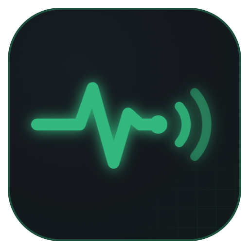
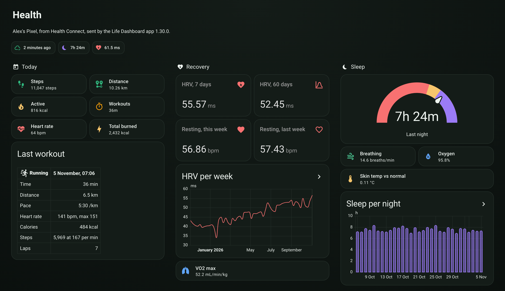
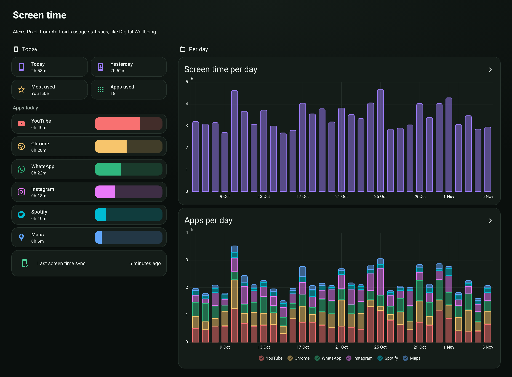
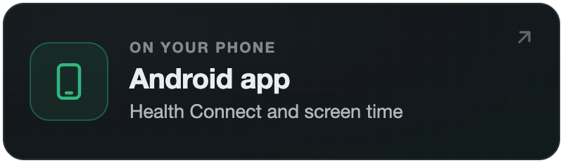
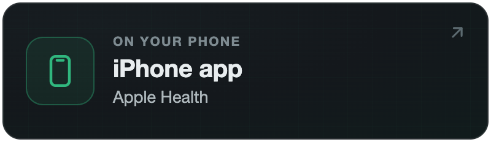
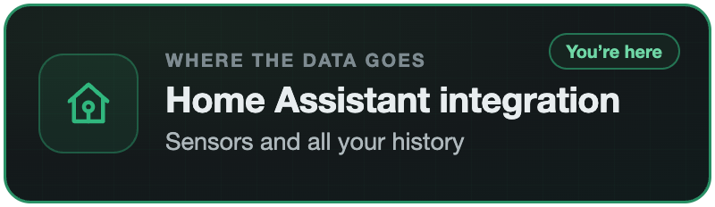
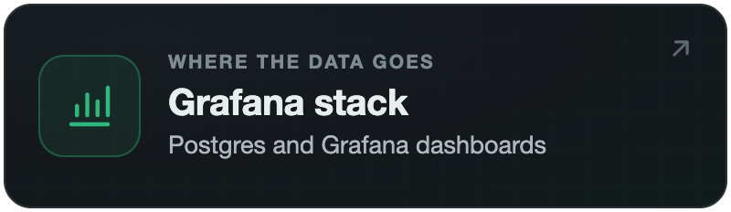

  

<h1 align="center">Life Dashboard for Home Assistant</h1>

  <b>Steps, sleep, heart rate, weight and workouts from your phone as Home Assistant sensors, with all your history.</b> 
  From Samsung Health, Fitbit, Garmin, Oura, Withings or Apple Health. Paired with a QR code: no broker, no YAML to set up.

  
  
  
  

  <a href="https://github.com/owen282000/life-dashboard-ha#quick-start"><b>Quick&nbsp;start</b></a>
  &nbsp;·&nbsp;
  <a href="https://github.com/owen282000/life-dashboard-ha/blob/main/docs/dashboard.md">Dashboard</a>
  &nbsp;·&nbsp;
  <a href="https://github.com/owen282000/life-dashboard-ha/blob/main/docs/pairing.md">Pairing</a>
  &nbsp;·&nbsp;
  <a href="https://github.com/owen282000/life-dashboard-ha/blob/main/docs/entities.md">Sensors</a>

  Life Dashboard: <a href="https://github.com/owen282000/life-dashboard-companion-app">Android app</a> &nbsp;·&nbsp; <a href="https://github.com/owen282000/life-dashboard-companion-app-ios">iPhone app</a> &nbsp;·&nbsp; <b>Home Assistant integration</b> &nbsp;·&nbsp; <a href="https://github.com/owen282000/life-dashboard-stack">Grafana stack</a>

You need the Life Dashboard Companion app on your phone, a separate app from the Home Assistant Companion app, to send your data here.

 

  
   
  An example <a href="https://github.com/owen282000/life-dashboard-ha/blob/main/docs/dashboard.md">dashboard</a> to copy, built from Home Assistant's own cards. The screenshot shows demo data.

## What you get

- **Sensors for today.** Steps, distance and calories as day totals, and the latest heart rate, sleep, weight, blood pressure, glucose and more, each with the app that recorded it.
- **All your history.** Every day goes into long-term statistics on its own date, so a backfill from the phone fills the **Statistics graph** card as far back as the phone has data, with distance in km and sleep in hours. Use that card for the past: a sensor's own history only knows when a value arrived, so a backfill would land on a single day there.
- **Workouts.** The last workout and the minutes of today and yesterday, with every session's kind, start and end, and what was recorded during it: calories, distance, pace or speed, heart rate, steps, and on Android laps and sets. A shortest workout setting keeps the walks the phone notices by itself out.
- **Screen time per app** (Android). Today and yesterday, the most used app and the top five, and per app a sensor and its history if you want one.
- **Back into Health Connect** (Android). Map a scale or blood pressure entity, and the phone writes each new reading into Health Connect. Samsung Health and Google Health pick up weight and body fat from there.
- **A dashboard and a theme to copy.** The example [Health dashboard](https://github.com/owen282000/life-dashboard-ha/blob/main/docs/dashboard.md) above, a screen time view, a view for two phones side by side, and a theme in the colors of the apps, all from Home Assistant's own cards. It's an example: you paste it into a new dashboard and fill in your phone's name and ID.

  
   
  Screen time per app on Android, from the usage statistics Digital Wellbeing reads too, with each app's time per day once you pick it. Demo data.

## How it works

The app sends your data straight to your Home Assistant, signed so nobody else can fake it. It reads Health Connect or Apple Health and posts each sync to a webhook this integration sets up when you add the phone, and the integration checks the HMAC signature before it reads anything. [How it works](https://github.com/owen282000/life-dashboard-ha/blob/main/docs/how-it-works.md) has the timing and why nothing is counted twice.

## Quick start

About ten minutes, on the phone and in Home Assistant 2026.3 or newer. From 2026.11 nothing else needs installing; older versions need [HACS](https://hacs.xyz/docs/use/).

1. **On the phone, first.** Install the Life Dashboard Companion app.
   - **Android:** buy it once for €4.99 (US$4.99) on [Google Play](https://play.google.com/store/apps/details?id=com.owen282000.lifedashboard&referrer=utm_source%3Dgh-ha-readme%26utm_medium%3Dreadme), with automatic updates. The same app is free [from GitHub](https://github.com/owen282000/life-dashboard-companion-app#install), on [F-Droid](https://f-droid.org/packages/com.owen282000.lifedashboard/) or through Obtainium.
   - **iPhone:** buy it once for EUR 6.99 (USD 5.99) on the [App Store](https://apps.apple.com/app/apple-store/id6824075761?pt=128699800&ct=gh-ha-readme&mt=8), or [build it yourself with Xcode](https://github.com/owen282000/life-dashboard-companion-app-ios#build-it-yourself) on a Mac. Building it yourself needs an Apple Developer Program membership, which costs USD 99 a year.

   On Android, switch on syncing to Health Connect in your watch's app: in Samsung Health it's **Settings > Health Connect**, and Fitbit, Garmin Connect and others have a similar setting. Then open Life Dashboard and allow it to read Health Connect, including in the background. On an iPhone, an Apple Watch syncs to Apple Health by itself: allow Life Dashboard to read Apple Health, and keep Background App Refresh on.
2. **Install the integration.** In **Settings > Marketplace** (HACS before Home Assistant 2026.11), search for **Life Dashboard** and install it. The first time, the Marketplace shows a notice about community projects that you need to accept. On HACS, download it and restart Home Assistant.

   

3. **Add a phone.** The Marketplace opens the setup by itself. Otherwise go to **Settings > Devices & services > Add integration** and search for **Life Dashboard**. Give the phone a name. The address is the one the phone sends to; see [the next section](https://github.com/owen282000/life-dashboard-ha#reaching-home-assistant-from-the-phone) if you're not sure.
4. **Scan the code** in the app, with **Scan a pairing code**, or with the phone's camera. The app shows what it will fill in and asks you to confirm. Is Home Assistant open on that same phone? Then you can't scan it: open **Or paste by hand** under the code and paste the URL and the secret into the app.
5. **Sync.** Tap **Sync Now**. The phone shows up as a device under **Settings > Devices & services > Life Dashboard**, with a sensor for every type it sent. To fill in your history, tap **Send history** under **What to send** on the app's **Health** tab and pick how far back. For screen time on Android, pick **Screen Time** under **Send from** when you pair, and allow usage access on the app's **Screen Time** tab.

If the sensors stay empty, the phone's [troubleshooting page](https://owen282000.com/life-dashboard/troubleshooting/) goes through it step by step.

## Reaching Home Assistant from the phone

The phone sends its data to the address in the pairing code, so that address has to work from the phone.

- **Only at home:** your home network address, such as `http://192.168.1.10:8123` (Settings > System > Network). `homeassistant.local` often doesn't work on Android, and on an iPhone plain `http://` works only to an IP address or a `.local` name. Syncs away from home wait until you're back.
- **Also away from home:** a VPN to your home network (WireGuard, Tailscale), with the home address kept as it is; your own `https://` address through a reverse proxy; or Home Assistant Cloud, which the dialog offers when you have a subscription.

[Pairing](https://github.com/owen282000/life-dashboard-ha/blob/main/docs/pairing.md) has the details, a second phone and changing the address later.

## Already use the Home Assistant Companion app?

Keep it: it handles presence, notifications and device sensors, and this works next to it. It also reads health data: on Android it turns dozens of Health Connect types into sensors, and on an iPhone recent versions of the app have Apple Health sensors as a Labs feature. If you only want today's values, the Companion app is enough.

What this integration adds, the screen time and the readings back on Android only:

- **History on the days it happened.** The Companion app's sensors hold the current value, so their history starts when you switch them on. Here a backfill fills every day, as far back as the phone has data.
- **Workouts as sessions**, each with its kind, start and end, and what was recorded during it.
- **Screen time per app** on Android.
- **Readings back into Health Connect** on Android, from a scale or blood pressure monitor in Home Assistant.
- **A documented, signed payload**, described [field by field](https://github.com/owen282000/life-dashboard-companion-app/blob/main/docs/webhook.md), so you can build on it.
- **Nothing to lose if this project stops.** Your history is in Home Assistant's own statistics and stays there.

Prefer MQTT? Both Life Dashboard apps can publish with MQTT Discovery instead, for current values only.

## Part of Life Dashboard

Four projects, and you only install the parts you need: the app on each phone, then where the data goes. An Android phone and an iPhone send the same payload, so they can share one Home Assistant.

  
  
  
  

## Ask your own AI

Home Assistant has its own. With an AI conversation agent in Assist, or with its Model Context Protocol server for Claude and other MCP clients, an AI reads the sensors you expose to Assist, so it can tell you how long you slept last night or how many steps you have today. It sees the sensors as they are now, not the statistics behind your graphs. The integration itself contains no AI.

## Privacy and security

- **Your data goes from the phone to your Home Assistant.** The integration makes no requests of its own and has no telemetry or analytics. There's no server of mine in the path, and nothing to switch off if I stop.
- **Signed, always.** Every payload is signed with HMAC-SHA256 and a secret this integration created, and checked before anything is read. A leaked URL is useless without the secret. The QR code contains that secret, so treat it like a password. The signature proves who sent the data but doesn't encrypt it: use `https://` or a VPN when the data leaves your home network.
- **The QR code** is a link to a static pairing page on GitHub Pages, with the address and secret after the `#`. Browsers never send that part to a server. The page reads it in your browser to show it and hand it to the app, and sends it nowhere.
- **Backed up with Home Assistant.** Sensors and statistics live in Home Assistant's own database, so your regular Home Assistant backups include them.
- **Diagnostics** on the integration give a file for bug reports with the secret redacted and no health data in it.

[How it works](https://github.com/owen282000/life-dashboard-ha/blob/main/docs/how-it-works.md) explains the timing, why nothing is counted twice, and the security design. To report a vulnerability privately, see [SECURITY.md](https://github.com/owen282000/life-dashboard-ha/blob/main/SECURITY.md).

## Documentation

- [The Health dashboard](https://github.com/owen282000/life-dashboard-ha/blob/main/docs/dashboard.md): the example dashboard and theme to copy, with screen time and two phones
- [Sensors and statistics](https://github.com/owen282000/life-dashboard-ha/blob/main/docs/entities.md): every entity, screen time per app, automations
- [Sending measurements to the phone](https://github.com/owen282000/life-dashboard-ha/blob/main/docs/sending-to-the-phone.md): scales and blood pressure monitors into Health Connect
- [Troubleshooting](https://github.com/owen282000/life-dashboard-ha/blob/main/docs/troubleshooting.md): the questions that come up most, diagnostics and debug logging
- [What 1.x keeps stable](https://github.com/owen282000/life-dashboard-ha/blob/main/docs/compatibility.md): within 1.x an update never breaks your entities, statistics, automations or pairing
- [Changelog](https://github.com/owen282000/life-dashboard-ha/blob/main/CHANGELOG.md)
- Rather keep your history in Postgres and Grafana? That's the [Life Dashboard stack](https://github.com/owen282000/life-dashboard-stack).

## Help and contributing

Questions go to [Discussions](https://github.com/owen282000/life-dashboard-ha/discussions), bugs to [issues](https://github.com/owen282000/life-dashboard-ha/issues/new/choose). The integration is Python, and [CONTRIBUTING.md](https://github.com/owen282000/life-dashboard-ha/blob/main/CONTRIBUTING.md) has the developer setup and the tests. Pull requests are welcome. No GitHub account? Use the [feedback board](https://owen282000.com/life-dashboard/feedback/), which needs no account. Everything on it is public, so leave out health data, logs and webhook URLs.

## Support the project

Stars, shares and good bug reports all help. If you want to chip in for the evenings that go into it, there's [Ko-fi](https://ko-fi.com/owen282000). The integration stays free and open source (MIT) either way.
