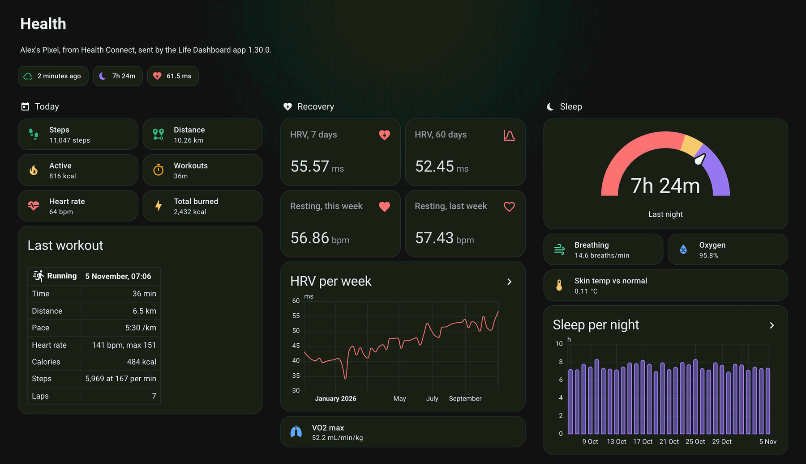
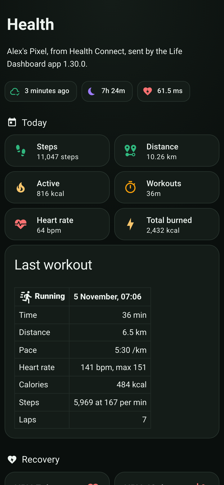
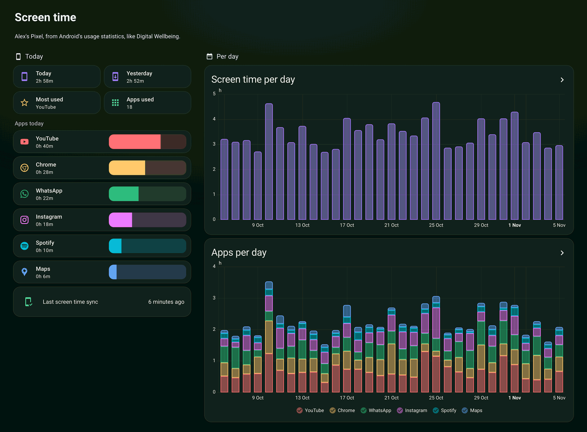
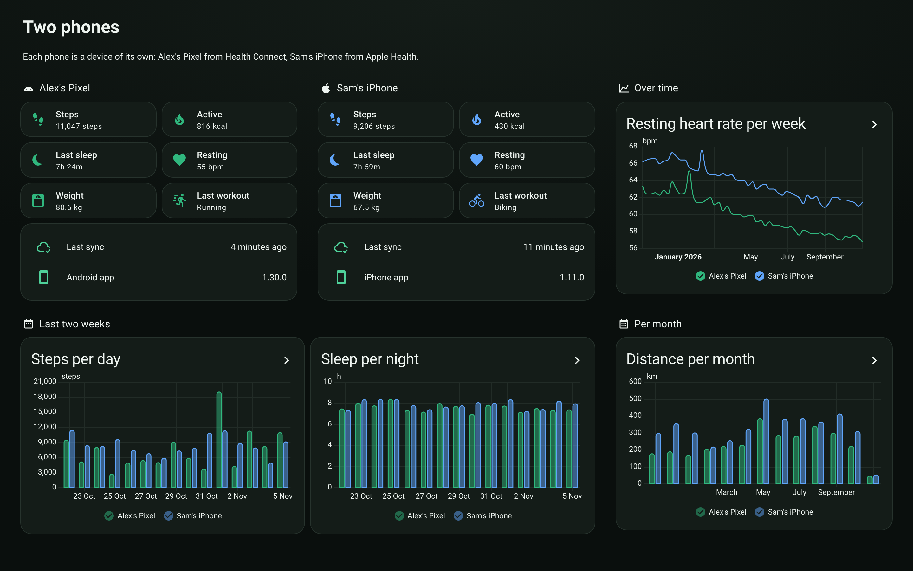

# The Health dashboard

An example dashboard for the integration, built only from Home Assistant's own cards, with a theme in the colors of the Life Dashboard apps. It isn't installed for you: you copy it, put your phone's name in, and remove what your phone doesn't send. No custom cards to install.

Want cards made for the job as well? The [Sleep card](#drawing-the-night) draws the night and the [Screen time cards](#screen-time-cards) show today, the week and the family. The [Activity, Year and Before bed cards](#activity-year-and-before-bed-cards) are newer. Each is a separate install from the Marketplace.

<p align="center">
  
</p>

The screenshots show demo data from two made-up phones, not a real person's.

## What's on it

The Health view, in [examples/dashboard.yaml](../examples/dashboard.yaml):

- **Today**: steps, distance, active and total calories, workout time and heart rate as tiles, and the last workout with what was recorded during it: pace, heart rate, calories, steps and laps.
- **Recovery**: heart rate variability over the last 7 days against your 60-day baseline, resting heart rate over the last 7 days against the 7 before, heart rate variability per week over a year, and VO2 max.
- **Sleep**: last night on a gauge, the night's breathing and oxygen, the skin temperature against your normal, sleep per night, and the sleep stages per night.
- **Training**: workout time this week, last week, this month and the last 4 weeks, today's workouts, workout time per week, and VO2 max per month.
- **Heart**: resting heart rate on average and per day, and heart rate over the last 48 hours.
- **Activity**: steps this week and this month, steps per day, distance per week from every activity, and active calories per day.
- **Body**: weight and body fat, per week over a year.
- **Sync**: when the phone last sent, and the app version.

The graphs read Home Assistant's long-term statistics, so a day shows up on its own date, also when it came in with a backfill. The graphs look back from 48 hours to a year; change `days_to_show` on a card to look further back. Distance is in km, and sleep and screen time in hours.

<p align="center">
  
</p>

The full page on a wide screen: [screenshots/dashboard-full-dark.png](screenshots/dashboard-full-dark.png).

## Setting it up

Do this on a computer: the raw configuration editor is much easier with a real keyboard and find and replace.

1. **The theme.** Home Assistant reads themes from a `themes` folder in its configuration folder.
   - Get to the files: on Home Assistant OS, install the **File editor** add-on, or use Samba or SSH.
   - Create a folder `themes` next to `configuration.yaml`, and put [examples/themes/life_dashboard.yaml](../examples/themes/life_dashboard.yaml) in it.
   - Add these lines to `configuration.yaml`, or only the `themes:` line if you already have a `frontend:` section:

     ```yaml
     frontend:
       themes: !include_dir_merge_named themes
     ```

   - Restart Home Assistant once. After that, the action `frontend.reload_themes` picks up a change to the file.

   The dashboard sets the theme itself, so your other dashboards keep theirs. The file also has a small theme, **Life Dashboard heart**, that colors the icons of the heart cards red. Don't want the themes? Skip this step and delete the `theme:` lines from the dashboard before you paste it.

2. **The dashboard.** Go to **Settings > Dashboards > Add dashboard > New dashboard from scratch**, give it a name and open it. Choose **Edit dashboard** from the three dots at the top right, then **Raw configuration editor** from the three dots again. Select everything that's there, paste [examples/dashboard.yaml](../examples/dashboard.yaml) in its place, and save.

3. **Your phone.** The file has two placeholders. Replace each with find and replace: in the editor itself (Ctrl+F, or Cmd+F on a Mac), or in a text editor before you paste.
   - **`your_phone`** in the entity IDs. Open your phone under **Settings > Devices & services > Life Dashboard**, click its steps sensor, then the cog. The entity ID reads like `sensor.alex_s_pixel_steps_today`, and the part between `sensor.` and `_steps_today` is what goes in place of `your_phone`.
   - **`<entry>`** in the statistic IDs, such as `life_dashboard:<entry>_steps`. Go to **Developer tools > Statistics** and search for your phone's name and "steps". The statistic ID reads like `life_dashboard:01j..._steps`, and the part between `life_dashboard:` and `_steps` is what goes in place of `<entry>`.

4. **What your phone doesn't send.** Your phone's device page lists the sensors it has. Remove the tiles and graphs for anything that isn't there, because Home Assistant shows a missing entity as an error.

   What a phone sends depends on the watch and its app:
   - **A Samsung Galaxy Watch** through Samsung Health shares no heart rate variability, resting heart rate, skin temperature or breathing with Health Connect, so remove Recovery, the night's breathing and skin temperature, and the resting heart rate cards.
   - **An iPhone** sends no skin temperature and no screen time. Its heart rate variability is SDNN where Android's is RMSSD, so it compares well with its own baseline but not with an Android phone's numbers ([entities.md](entities.md)).

The graphs start with what the phone has sent so far. To fill them with your history, tap **Send history** under **What to send** on the **Health** tab of the Life Dashboard app and pick how far back. The days land on their own dates, as far back as the phone has data.

## Drawing the night

For a chart that follows your theme and shows each stage on hover, there's the [Life Dashboard Sleep Card](https://github.com/owen282000/life-dashboard-sleep-card), a separate install from the Marketplace:

```yaml
type: custom:life-dashboard-sleep-card
entity: sensor.your_phone_last_sleep_asleep
```

[Lavve's Hypnogram card](https://github.com/Lavve/lovelace-hypnogram-card), also in the Marketplace, reads the same list from version 0.1.9:

```yaml
type: custom:hypnogram-card
entity: sensor.your_phone_last_sleep_asleep
stages_attribute: stages
state_mapping:
  deep_sleep: deep
  light_sleep: light
  rem: rem
  awake: awake
```

The `stages` attribute of `sensor.your_phone_last_sleep_asleep` holds the timeline for a card of your own. Two recipes for custom cards, neither of which this project installs. Neither has been run in a browser by this project, so treat them as a starting point.

[ApexCharts card](https://github.com/RomRider/apexcharts-card) has no range bars, so it draws the night as a stepped line:

```yaml
type: custom:apexcharts-card
header:
  show: true
  title: Last night
graph_span: 24h
yaxis:
  - min: 0
    max: 3
    apex_config:
      tickAmount: 3
series:
  - entity: sensor.your_phone_last_sleep_asleep
    name: Stage
    curve: stepline
    data_generator: |
      const lanes = { deep: 0, light: 1, sleeping: 1, unknown: 1, rem: 2, awake: 3, out_of_bed: 3 };
      const points = [];
      for (const part of entity.attributes.stages || []) {
        points.push([new Date(part.start).getTime(), lanes[part.stage]]);
        points.push([new Date(part.end).getTime(), lanes[part.stage]]);
      }
      return points;
```

[Plotly graph card](https://github.com/dbuezas/lovelace-plotly-graph-card) can draw colored lanes, one trace per stage, separated by `null`:

```yaml
type: custom:plotly-graph
hours_to_show: 24h
layout:
  showlegend: false
  yaxis:
    range: [-0.5, 3.5]
    fixedrange: true
    tickvals: [0, 1, 2, 3]
    ticktext: [Deep, Light, REM, Awake]
entities:
  - entity: ""
    mode: lines
    line: { width: 16, color: "#5157cf" }
    x: $fn ({ hass }) => (hass.states["sensor.your_phone_last_sleep_asleep"].attributes.stages || []).filter((p) => p.stage === "deep").flatMap((p) => [p.start, p.end, null])
    y: $fn ({ hass }) => (hass.states["sensor.your_phone_last_sleep_asleep"].attributes.stages || []).filter((p) => p.stage === "deep").flatMap(() => [0, 0, null])
  # And again for "light" at 1, "rem" at 2 and "awake" at 3, each with its own color.
```

## Screen time

<p align="center">
  
</p>

Screen time comes from the Android app only, so it has its own view in its own file: [examples/dashboard-screen-time.yaml](../examples/dashboard-screen-time.yaml). Paste it as a dashboard of its own, or copy its view under `views:` into the Health dashboard. Replace `your_phone` and `<entry>` the same way.

The six apps are examples. Each app gets a sensor that starts disabled: open the phone's device page, show the disabled entities, and enable the apps you want. An enabled app also gets a statistic with its time per day, `life_dashboard:<entry>_app_<package>`, with the dots of the package name as underscores, and that's what the stacked graph reads. It starts with the next sync, which carries the last seven days. More in [entities.md](entities.md#per-app).

### Screen time cards

For cards made for screen time there's [Life Dashboard Screen Time](https://github.com/owen282000/life-dashboard-screen-time-card), a separate install from the Marketplace (HACS before Home Assistant 2026.11). One install gives three cards, each against a daily limit you set: today on one phone, the week, and the whole family. From integration 1.2.0 they show every app of the day without enabling any app sensor, and the week comes from the statistics.

```yaml
type: custom:life-dashboard-screen-time-card
entity: sensor.your_phone_screen_time_today
limit: "3:30"
```

```yaml
type: custom:life-dashboard-screen-time-week-card
entity: sensor.your_phone_screen_time_today
limit: "3:30"
```

```yaml
type: custom:life-dashboard-screen-time-family-card
people:
  - entity: sensor.first_phone_screen_time_today
    person: person.sam
    limit: "3:30"
  - entity: sensor.second_phone_screen_time_today
    name: Mila
    limit: "2:00"
```

Add them next to the view above or in its place. The card's [README](https://github.com/owen282000/life-dashboard-screen-time-card#configure) has every option, and the other sources it reads, such as Google Family Link.

## Activity, Year and Before bed cards

Three more cards made for the job, each a repository of its own. In **Settings > Marketplace** (HACS before Home Assistant 2026.11), search for the card's name and download it. Every card has a visual editor, and its README has every option.

The [Life Dashboard Activity Card](https://github.com/owen282000/life-dashboard-activity-card) shows steps, active energy and exercise as rings against a daily goal, the last seven days, and how many days in a row you made it. Leave a ring out by leaving its sensor out:

```yaml
type: custom:life-dashboard-activity-card
steps: sensor.your_phone_steps_today
steps_goal: 10000
energy: sensor.your_phone_active_calories_today
energy_goal: 500
exercise: sensor.your_phone_exercise_today
exercise_goal: 30
```

The [Life Dashboard Year Card](https://github.com/owen282000/life-dashboard-year-card) draws a year as one square per day, for one metric or several. It reads the integration's statistics, so the days you sent with **Send history** are there from the start:

```yaml
type: custom:life-dashboard-year-card
metrics:
  - entity: sensor.your_phone_steps_today
    thresholds: [4000, 7000, 10000]
  - entity: sensor.your_phone_last_sleep_duration
    thresholds: [6, 7, 8]
  - entity: sensor.your_phone_exercise_today
```

The [Life Dashboard Before Bed Card](https://github.com/owen282000/life-dashboard-before-bed-card) sets the screen time in the last hour before you fell asleep next to the night that followed, for the last seven nights. The night comes from an Android phone or an iPhone, the screen from an Android phone only:

```yaml
type: custom:life-dashboard-before-bed-card
sleep_entity: sensor.your_phone_last_sleep_asleep
screen_entity: sensor.your_phone_screen_time_today
```

With `screen_time_today` the card estimates where the minutes fell between two syncs, and marks those numbers with `~`. For minutes that are exact, give it a sensor that is on while the screen is on, such as `binary_sensor.your_phone_interactive` of Home Assistant's Companion app. Its [README](https://github.com/owen282000/life-dashboard-before-bed-card#works-with-any-sensor) lists the sensors it reads.

## Two phones

<p align="center">
  
</p>

Every phone is a device of its own, an Android phone and an iPhone alike. [examples/dashboard-two-phones.yaml](../examples/dashboard-two-phones.yaml) puts two side by side and draws both in the same graphs. Replace `first_phone`, `second_phone`, `<first_entry>` and `<second_entry>` the same way, and the headings, names and phone icons in the graphs. Paste it as a dashboard of its own, or copy its view into the Health dashboard.

## Notes

- Home Assistant 2026.3 or newer, the same as the integration.
- The header line names the phone and where its data comes from, Health Connect or Apple Health, from the device and the last sync.
