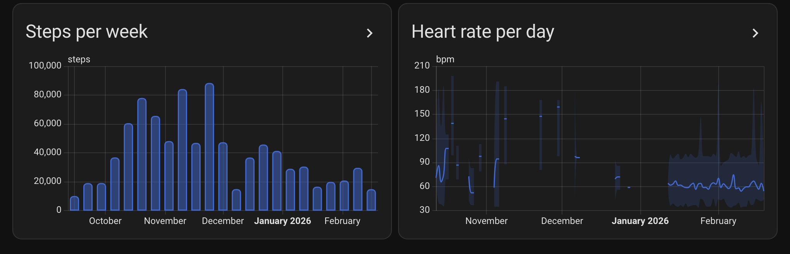

# Sensors and statistics

Each phone is one device, with a sensor for every value it sends and long-term statistics for the past. This page lists all of them, with the attributes, the screen time sensors per app, an example dashboard and a few automations.

- [What you get](#what-you-get)
- [Exercise](#exercise)
- [Sleep stages](#sleep-stages)
- [Screen time](#screen-time)
- [A dashboard to start from](#a-dashboard-to-start-from)
- [History](#history)
- [In automations](#in-automations)

## What you get

Sensors appear as data arrives, so you only get the types you actually sync. Each sensor holds the latest value; the past lives in the [statistics](#history).

The tables give the last part of each entity ID. The first part is the device name, so a phone named "Owen's Pixel" gives `sensor.owen_s_pixel_steps_today`.

The device's firmware field shows the app version the phone last reported, so you can see which version each phone runs.

### Day totals

These come from Health Connect's own deduplicated figures, or HealthKit's statistics on an iPhone. Each covers one local day from midnight and carries that day as a `date` attribute. A sensor moves on to the new day with the first sync after midnight.

| Sensor | Unit |
|---|---|
| `steps_today` | steps |
| `distance_today` | km |
| `active_calories_today` | kcal |
| `total_calories_today` | kcal |

### Latest reading

Each holds the newest record, with the time it describes as `measured_at`, the app that wrote it as `source` and the record ID as `uuid`. A series that the app sends in time buckets (an average per 1, 5 or 15 minutes, or per hour) carries `sample_count`, `min`, `max` and `sources` instead.

| Sensor | Unit | | Sensor | Unit |
|---|---|---|---|---|
| `heart_rate` | bpm | | `body_temperature` | °C |
| `resting_heart_rate` | bpm | | `skin_temperature_delta` | °C |
| `heart_rate_variability` | ms | | `basal_body_temperature` | °C |
| `last_sleep_duration` | h | | `respiratory_rate` | breaths/min |
| `weight` | kg | | `last_drink` | L |
| `blood_pressure_systolic` | mmHg | | `body_fat` | % |
| `blood_pressure_diastolic` | mmHg | | `lean_body_mass` | kg |
| `blood_glucose` | mmol/L | | `bone_mass` | kg |
| `oxygen_saturation` | % | | `body_water_mass` | kg |
| `basal_metabolic_rate` | kcal/d | | `vo2_max` | mL/min/kg |
| `height` | m | | `speed` | m/s |

**Heart rate variability** is the measure each phone's health store keeps: RMSSD from Health Connect on Android, SDNN from Apple Health on an iPhone. Both are in milliseconds, but they are calculated differently, so compare a phone with itself rather than with the other kind. Every phone has its own entry, so the two never mix. Only if you move from Android to an iPhone and keep using the same entry does the line jump at the switch; add the new phone as a new entry to keep them apart.

### Exercise sensors

[Exercise](#exercise) below explains them.

| Sensor | State | Attributes |
|---|---|---|
| `last_workout` | the kind of the newest workout, such as `running` | `start`, `end`, `duration_minutes`, `type_code`, `source`, `uuid`, `measured_at`, and its [details](#workout-details) |
| `exercise_today` | min | `date`, `sessions` |
| `exercise_yesterday` | min | `date`, `sessions` |

### Last sleep

The newest night with stages, so not always the newest session: `last_sleep_duration` is the latest session of any kind, including a nap, while these are the newest main night ([what that means](#sleep-stages)).

| Sensor | State | Attributes |
|---|---|---|
| `last_sleep_asleep` | Hours actually asleep | `night` (wake date), `start`, `end`, `source`, the minutes of the night as `asleep_minutes`, `deep_minutes`, `light_minutes`, `rem_minutes`, `awake_minutes`, `stages` and `measured_at` |
| `last_sleep_deep`, `last_sleep_light`, `last_sleep_rem`, `last_sleep_awake` | Hours of that stage, `unknown` when the night has none to report | `night`, `measured_at` |

The `last_sleep_` sensors other than `last_sleep_asleep` start disabled. A sensor in this table appears with the first night that has stages, and the chart as well; before that there is nothing to draw and no entity.

### Screen time sensors

Android only. [Screen time](#screen-time) below explains them.

| Sensor | Unit | Attributes |
|---|---|---|
| `screen_time_today` | h | `date`, `app_count`, `top_apps` (the top five with their minutes) |
| `screen_time_yesterday` | h | `date`, `app_count`, `top_apps` |
| `most_used_app_today` | the app's name | `package`, `minutes`, `date` |
| `<app>_screen_time`, one per app, [disabled](#per-app) until you enable it | h | `app`, `package`, `date`, `week_minutes` |

When **Apps to send** in the app leaves some apps out, `screen_time_today` and `screen_time_yesterday` count only the apps that are sent, and carry the total of every app as `all_apps_minutes`.

### Diagnostics

`last_health_sync` and `last_screen_time_sync` are timestamps of the last payload of each kind. `last_health_sync` also carries the app version and how many records the payload held; `last_screen_time_sync` carries the app version and the phone's manufacturer and model.

A **Test ping** in the app updates the one for its tab, which is the quickest way to see that pairing worked. A backfill doesn't; the next regular sync does.

### What gets no sensor

Eight of the 34 Health Connect types are event-like: meals, mindfulness sessions, sexual activity and the cycle tracking types (period, flow, intermenstrual bleeding, ovulation tests, cervical mucus). A single value can't represent them honestly, so they get no sensor. Mindfulness does count toward the [day statistics](#history). Workouts are event-like too, and get [sensors](#exercise) that show the last one and the sessions of the last two days.

For the raw records, add a second webhook URL in the app that points at your own backend or at an automation with a webhook trigger. Neither this integration nor MQTT passes them on.

## Exercise

The phone sends every workout as a session: its kind, when it started and ended, and how long it was. Three sensors come out of that:

| Sensor | What it holds |
|---|---|
| `last_workout` | The kind of the newest workout, such as `running`, `walking`, `strength_training` or `yoga`. The attributes give its `start` and `end` and `duration_minutes`, the `type_code` as the phone sent it (`56` on Android, `running` on an iPhone) and the app that wrote it as `source`. |
| `exercise_today` | The minutes of workouts since local midnight. |
| `exercise_yesterday` | The finished total for the day before. |

Both minutes sensors carry the day as `date`, and every session of that day in `sessions`: its `type`, `start`, `end` and `minutes`, oldest first, and its [details](#workout-details). Times are in Home Assistant's time zone.

- **Time counts once.** The state is the time of the day that had a workout going, rounded once. When two sessions overlap, as when the phone and the watch both write the same run, or two apps do, that time counts once: the run is 60 minutes, while `sessions` lists both copies. Ten short sessions of 40 seconds make 7 minutes, so the state can differ by a minute from the minutes in the list, which are rounded per session.
- **Deleted and edited workouts.** A workout you delete on the phone leaves both sensors at the next sync. On an iPhone an edit arrives as the old workout deleted and a new one written, so a run shortened from 60 to 45 minutes counts as 45.

- **Kinds.** There are 62, such as `running`, `biking`, `biking_stationary`, `strength_training`, `weightlifting`, `hiit`, `yoga`, `swimming_pool`, `hiking`, `rowing_machine`, `soccer` and `other`, each with an English and a German name. Health Connect's exercise types and HealthKit's activities are mapped to the same ones. A type that has none, or one that a newer Health Connect or iOS added, reads as `other`, and `type_code` still says what it was.
- **Midnight.** A workout that crosses midnight counts for the part on each day: 23:30 to 00:30 is 30 minutes in `exercise_yesterday` and 30 in `exercise_today`, and the session is listed on both days with its real start and end. The two minutes sensors move on at midnight, without waiting for a sync.
- **Two days.** The integration keeps the sessions of yesterday and today. They're stored by record ID, so a session that arrives again or is edited replaces itself, and one the app reports as deleted goes. `last_workout` has no such limit: it keeps the newest workout until a newer one comes.
- **Shortest workout.** **Configure** on the integration has **Shortest workout (minutes)**, 0 by default. A workout that is shorter is left out of all three sensors. A phone or a watch that notices a walk by itself gives sessions of 10 or 15 minutes, and a value like 20 keeps them out. The sessions are kept whole, so changing it applies to today and yesterday at once. `last_workout` follows it from the next workout on.
- **The statistic is different.** The long-term statistic `exercise_minutes` counts every session whatever its length, and books it on the day it ended, as before. It is a day sum for a graph; the sensors say what happened on the day.
- A phone that sends no workouts gets no exercise sensors.

### Workout details

`last_workout`, and every entry of `sessions`, also carry what the other records of the workout's time say about it. A key is left out when nothing was recorded for it.

| Attribute | What it is |
|---|---|
| `active_calories`, `total_calories` | kcal during the workout |
| `distance_km` | From the distance records, or the sum of the laps when there are none |
| `pace_min_per_km`, `pace` | Running, treadmill, walking and hiking: minutes per km as a number (`5.2`) and as `5:12` |
| `speed_kmh` | Biking and stationary biking |
| `heart_rate_avg`, `heart_rate_min`, `heart_rate_max` | bpm, from every sample during the workout |
| `steps`, `cadence_spm` | Steps during the workout; for running, walking and hiking also steps per minute |
| `laps` | How many laps the recording app wrote |
| `sets`, `repetitions`, `exercises` | For a workout with sets: how many (rests and pauses not counted), the repetitions in total, and per exercise its `type` (such as `squat`, `bench_press` or `pull_up`, from Health Connect's exercise segment types; `other` for one it does not know), the `type_code` as sent, `sets` and `repetitions` |

```yaml
# What the last workout's attributes can look like.
start: "2026-10-04T09:00:00+02:00"
end: "2026-10-04T09:50:00+02:00"
duration_minutes: 50
type_code: "56"
source: org.example.watch
active_calories: 400
distance_km: 10.0
pace_min_per_km: 5.0
pace: "5:00"
heart_rate_avg: 140
heart_rate_min: 130
heart_rate_max: 149
steps: 8000
cadence_spm: 160
```

- **One app's figures.** Calories, distance and steps are never added up across apps, because a phone and a watch often both write the same walk. The app that wrote the workout counts; when it wrote none, the app with the most. Heart rate takes every app's samples, since two copies of a sample do not change an average.
- **Records across the edges.** A record that is partly inside the workout counts for the part that is: 100 kcal from 06:40 to 07:20 is 50 kcal for a run that started at 07:00.
- **Late records.** A watch can upload a workout's heart rate hours later, and a phone that syncs every 15 minutes sends the first part of a run before the run itself. The details follow whenever the records come: the integration keeps the records of the kept workouts, and those of the last 6 hours for a workout still to come. A record sent again or edited replaces itself, and one the phone reports as deleted leaves the details.
- **Buckets.** With a [data resolution](https://github.com/owen282000/life-dashboard-companion-app/blob/main/docs/webhook.md#data-resolution) set for heart rate or for calories, distance and steps, the buckets are read instead, a heart rate bucket weighted by its samples.
- **Older workouts.** The details of a workout older than yesterday, such as from a backfill, come from the records in the same payload only.

```yaml
# Today's workouts in a card.
type: markdown
title: Today's workouts
content: |-
  
  - {{ s.minutes }} min {{ s.type | replace('_', ' ') }}, {{ s.distance_km }} km, {{ s.heart_rate_avg }} bpm
  
```

```yaml
# Nothing counted by evening.
triggers:
  - trigger: time
    at: "19:00:00"
conditions:
  - condition: numeric_state
    entity_id: sensor.owen_s_pixel_exercise_today
    below: 1
actions:
  - action: notify.mobile_app_owen_s_pixel
    data:
      message: "No workout today."
```

## Sleep stages

A night's stages become sensors and statistics by the rules of the wake date, the date the session ended on in Home Assistant's time zone.

**The main night.** A date gets one main night: the session with the most time asleep, then the longest, and a stable tie-break on the record ID. Naps and a second app that wrote the same night don't add up with it; they stay in the statistic `sleep_minutes`, which counts every session whole on the day it ended. That is why `sleep_minutes` and the stage statistics differ: `sleep_minutes` is the record's duration including time in bed and awake, and the stages are the stages.

**Counting.** A stage counts only when its source is the session's source, or it has no source of its own; an older iOS app that doesn't send a session source has no filter, and every stage is taken. `in_bed` never counts, and where stages overlap each moment goes to the most specific one, in the order deep, REM, light, sleeping, awake, unknown, so nothing counts twice. `sleeping` is time asleep with no detail; `awake`, `awake_in_bed` and `out_of_bed` are awake; `unknown` is in no sum, but is drawn. A night with at least one of deep, light and REM counts the others, and awake, as 0. A night with only `sleeping` has time asleep and awake but no deep, light or REM. A night that only has `in_bed`, `unknown` or `awake` has nothing to report: no main night, no row and no sensor update.

**`stages`.** The `stages` attribute of `last_sleep_asleep` is the night's timeline, a list of objects with `stage`, `start` and `end` (ISO 8601 in the local time zone), sorted, not overlapping, and adjacent equal stages merged. `stage` is one of `awake`, `light`, `deep`, `rem`, `sleeping`, `out_of_bed` and `unknown`; `awake_in_bed` is listed as `awake` and `in_bed` is left out. It can be long, so the recorder doesn't keep it, but it is on the state and it comes back after a restart. The [dashboard page](dashboard.md#drawing-the-night-yourself) shows how to draw it in other cards.

**Corrections.** A record that arrives again changes nothing; an edit replaces the night by its record ID, and an older copy of a night that was edited or deleted since doesn't undo that. A deleted night leaves the statistics of its date and the running sum, and the sensors fall back to the night before. A day that ends up with no sleep keeps a row at 0 in `sleep_minutes`, because that row already exists and has to move with the running sum. An iPhone deletes a stage rather than a night: the integration takes it out, and a night with no stages left goes away. Older than the last 14 nights the stages are no longer kept, so a stage deleted there changes nothing.

**A night under a new record ID.** An iPhone's session ID follows its earliest sample, so a night that gains an earlier sample, or two sessions that merge, can arrive under a new ID with no deletion of the old one. The integration notices when the two share a stage and drops the old one. Without a stage in common, as for a night older than the last 14, the two stand next to each other: the stage statistics still count only the main session, but `sleep_minutes` counts both.

**Old nights.** Nights from before the update don't have their stages kept. To fill the stage statistics, use **Send history** in the app, on the **Health** tab under **What to send**: every sent night lands on its own date, and sending the same window again changes nothing. A new phone that [took over](pairing.md#taking-over-the-history-of-a-removed-phone) a removed phone's statistics can do the same. A night more than 400 days older than the newest one the integration keeps is no longer taken in; its row stays as it was.

**MQTT.** Over MQTT the apps publish one sleep sensor, the session's duration. The stage sensors and the stage statistics are this integration's.

## Screen time

The Android app reads Android's usage statistics, the same numbers as the Digital Wellbeing screen, and sends them on their own schedule, separate from the health sync. Three sensors come out of it:

| Sensor | What it holds |
|---|---|
| `screen_time_today` | Time on the phone in the foreground, in hours, since the day boundary, which you set in the app (a "day" can end at 4 AM if that's when you sleep). |
| `screen_time_yesterday` | The finished total for the day before, for a daily automation that doesn't race the clock. |
| `most_used_app_today` | The app with the most minutes today, with its package name and minutes as attributes. It reads `none` when **Apps to send** leaves out every app used today. The top five with their minutes are the `top_apps` attribute of both minutes sensors. |

Both sensors carry the day they describe as an attribute, and update as the number grows, so a dashboard shows the phone's day as it happens. Every day also goes into long-term statistics, so a year from now the statistics graph still shows your heaviest phone weeks.

Two things people do with it:

```yaml
# Say something when the phone passes three hours in a day.
triggers:
  - trigger: numeric_state
    entity_id: sensor.owen_s_pixel_screen_time_today
    above: 3
actions:
  - action: notify.mobile_app_owen_s_pixel
    data:
      message: >-
        Three hours on the phone today.
        Top app: {{ states('sensor.owen_s_pixel_most_used_app_today') }}.
```

```yaml
# Yesterday's total and its top five apps in a card.
type: markdown
title: Yesterday on the phone
content: >-
  {{ (states('sensor.owen_s_pixel_screen_time_yesterday') | float(0) * 60) | round }} minutes.
  {{ state_attr('sensor.owen_s_pixel_screen_time_yesterday', 'top_apps') }}
```

Screen time is Android only: iOS has no API that lets an app read it and send it anywhere. Which apps count is decided on the phone, so Home Assistant only ever sees what you chose to send.

### Per app

The apps you use also get a sensor each with their time today, such as `sensor.owen_s_pixel_youtube_screen_time`. They're created disabled, so the device page stays as it was. Open the device, show the disabled entities, and enable the apps you want a sensor for. Home Assistant reloads the integration about 30 seconds later, and the sensor shows today's minutes right away.

- The sensor belongs to the app's package, not its name, so a renamed app keeps its sensor and entity ID. The new name shows up in the `app` attribute right away, and the entity name follows at the next restart.
- An app that's missing from a newer day reads 0 for that day, even when you leave it out of **Apps to send**: it never keeps yesterday's minutes. `week_minutes` holds its minutes over the days the last sync carried, up to seven.
- An app gets a sensor once it has 5 minutes over those days, so an app opened once for a moment gets none. A phone gets 50 app sensors at most, disabled ones included, the most used apps first. An app keeps its sensor when you stop using it, so automations built on it keep working.
- A sensor you delete stays deleted, even after a restart and while the phone keeps sending the app, and it frees its slot. Removing the phone and adding it again is the only way to get it back.
- An app you leave out of **Apps to send** never reaches Home Assistant and gets no sensor.
- Like `screen_time_today` they have no state class, so the sensor itself shows only the newest day. Each enabled app also gets a long-term statistic of its own, `life_dashboard:<entry>_app_<package>` (the package with its dots as underscores, such as `app_com_google_android_youtube`), with its time per day in hours. Put it in a statistics graph to see the app over weeks or a year. It starts when you enable the sensor, with the days the next sync carries, up to seven back.

```yaml
# Turn the TV off after an hour of a game on a school day.
triggers:
  - trigger: numeric_state
    entity_id: sensor.kids_tablet_minecraft_screen_time
    above: 1  # hours since 1.0.0
conditions:
  - condition: time
    weekday: [mon, tue, wed, thu, fri]
actions:
  - action: media_player.turn_off
    target:
      entity_id: media_player.living_room_tv
```

## A dashboard to start from

The [Health dashboard](dashboard.md) puts these sensors and statistics on one page, with a theme in the colors of the apps and a view for two phones side by side. It uses only Home Assistant's own cards: copy it, replace your phone's name, and remove what you don't sync.

## History

A sensor can only hold now, so on its own a year of backfilled readings would all land on today. Instead every payload also feeds long-term statistics, which carry their own dates. The sensors themselves have no state class, so the recorder doesn't compile a second set of statistics from them, except for the [last sleep](#last-sleep) sensors: the measurement of a night, which the recorder may keep as such. A sensor's own history shows when each value arrived, so after a backfill [it puts everything on today](troubleshooting.md#why-does-a-sensors-history-put-a-whole-backfill-on-today); chart the statistic instead.

| Statistic | What it holds |
|---|---|
| `steps`, `distance` (km), `active_calories`, `total_calories` (kcal) | The day's total, from the app's daily totals. |
| `sleep_minutes`, `exercise_minutes`, `mindfulness_minutes` | The day's total in hours (the IDs keep their old names), from the sessions that ended that day. A workout that crosses midnight counts whole on the day it ended here, where the [exercise sensors](#exercise) split it. |
| `hydration_total` | Liters drunk that day. |
| `screen_time` | Hours on the phone that day. Every sync carries the last seven days, so a day that was still running when it was sent is corrected by the next one. |
| `app_<package>` | Hours in one app that day, for each app whose [sensor](#per-app) you enabled. |
| `sleep_deep`, `sleep_light`, `sleep_rem`, `sleep_awake`, `sleep_asleep` | Hours of the [main night](#sleep-stages) of a wake date, one row per date as a mean: chart them with `stat_types: mean`, per day, week or month. A date with no main night, or a stage its source doesn't report, has no row. |
| `heart_rate`, `weight`, `blood_pressure_systolic`, `blood_pressure_diastolic` and every other value in the [latest reading](#latest-reading) table except sleep and the last drink | Mean, minimum and maximum per hour. |

A day without data has no row, rather than a zero. Each statistic's ID is `life_dashboard:<entry>_<statistic>`, where `<entry>` is the phone's config entry ID in lowercase, and its name is the device name followed by the statistic, such as "Owen's Pixel steps".

They show up in the entity picker of the **Statistics graph** card under the phone's name, next to the sensors. The steps chart in the screenshot is this card:

```yaml
type: statistics-graph
title: Steps per week
chart_type: bar
period: week
days_to_show: 90
stat_types:
  - change
entities:
  - life_dashboard:<entry>_steps   # pick "Owen's Pixel steps" from the picker
```

Distance is stored in km, and sleep, workouts, mindfulness and screen time in hours, so a statistics graph reads 42 km and 7.5 h without any setting. Home Assistant can't convert the unit of an external statistic in a graph, which is why they are stored that way. Steps, calories, water and weight keep steps, kcal, L and kg.

<p align="center">
  
</p>

A backfill from the app fills the statistics for the whole window it covers, and sending the same window again changes nothing. [How it works](how-it-works.md#why-nothing-is-double-counted) explains why. When you remove the phone, its statistics stay in the recorder.

## In automations

The sensors are ordinary sensors. Two that people set up first:

```yaml
# A goal for the day.
triggers:
  - trigger: numeric_state
    entity_id: sensor.owen_s_pixel_steps_today
    above: 10000
actions:
  - action: notify.mobile_app_owen_s_pixel
    data:
      message: "10,000 steps. Done for today."
```

```yaml
# The phone hasn't synced for a day, so something is off with the app or the network.
triggers:
  - trigger: template
    value_template: >-
      {{ now() - (states('sensor.owen_s_pixel_last_health_sync') | as_datetime)
         > timedelta(hours=24) }}
actions:
  - action: notify.mobile_app_owen_s_pixel
    data:
      message: "No health sync from the phone for a day."
```
